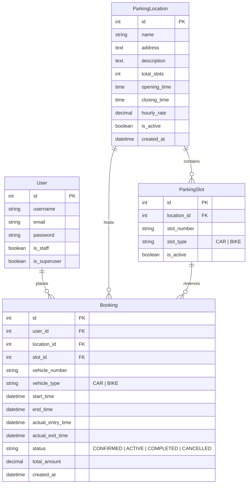

# ParkEase: Cost-Effective Smart Parking Management System

[](https://www.python.org/)
[](https://www.djangoproject.com/)
[](https://getbootstrap.com/)
[]()
[]()

> A robust, role-based, cost-effective smart parking management system built with Python, Django, SQLite, Bootstrap 5, and Chart.js. Designed for urban facilities, universities, and commercial shopping centers.

---

## 1. Project Overview

**ParkEase** is a web-based smart parking reservation and operations management system designed to eliminate urban parking congestion, prevent reservation conflicts, and provide real-time occupancy and revenue analytics. The system delivers an intuitive, frictionless digital experience for drivers seeking parking bays while providing parking operators and administrators with powerful management tools.

---

## 2. Problem Statement

Rapid urbanization and vehicular growth have intensified parking challenges in metropolitan areas, commercial districts, and academic campuses:
- **Time and Fuel Waste:** Drivers spend an average of 15–20 minutes circling blocks to locate available parking bays, resulting in wasted fuel and heightened carbon emissions.
- **Manual & Error-Prone Operations:** Traditional paper ticketing or manual barrier logging suffers from record tampering, lost tickets, inaccurate duration tracking, and lack of real-time auditing.
- **Double Booking & Congestion:** Without centralized reservation tracking, multiple drivers compete for the same bays during peak hours.
- **Lack of Operational Intelligence:** Facility managers lack actionable analytics on revenue, vehicle turnover, and bay occupancy bottlenecks.

---

## 3. Project Objectives

1. **Centralized Bay Reservation:** Provide an online self-service portal where drivers can locate active facilities, inspect bay availability, and reserve bays in advance.
2. **Dynamic Duration-Based Pricing:** Automate fee calculation based on scheduled reservation duration and actual parked time ($$\text{Fee} = \text{Hourly Rate} \times \text{Duration}$$) using high-precision Decimal arithmetic.
3. **Role-Based Operational Security:** Separate Driver customer privileges from Staff operational check-in/check-out duties and Admin management permissions.
4. **Interactive Bay Visualization:** Deliver a visual grid of parking bays (Car vs Bike) indicating live occupancy status (Available, Reserved, Occupied, Inactive) with 1-click booking capability.
5. **Real-time Analytics:** Equip operators with responsive Chart.js analytics tracking occupancy trends, daily turnover, and revenue generation.

---

## 4. Key Features

### For Drivers (Customers):
- **User Authentication:** Registration with email validation, secure login, password validation, and profile management.
- **Facility Directory:** Search and browse active parking locations filtered by rate, vehicle type, and capacity.
- **Interactive Bay Picker:** Visual layout displaying available Car and Bike bays with color-coded live statuses.
- **Dynamic Slot Selection:** AJAX-driven booking form that fetches available slots in real time for selected time windows.
- **My Bookings Dashboard:** Comprehensive booking history with `.pe-status-badge` indicators (`CONFIRMED`, `ACTIVE`, `COMPLETED`, `CANCELLED`).
- **Reservation Cancellation:** One-click cancellation for upcoming confirmed bookings that immediately restores slot availability.

### For Parking Staff (Operators):
- **Operations Dashboard:** Live command center displaying occupancy rates, active parking sessions, and daily revenue.
- **Vehicle Check-In:** Log vehicle arrival, transition status from `CONFIRMED` to `ACTIVE`, and record `actual_entry_time`.
- **Vehicle Check-Out:** Log vehicle departure, transition status from `ACTIVE` to `COMPLETED`, calculate final fee based on actual parked duration, and free the bay.
- **Operational Filters:** Filter live booking logs by status, vehicle type, location, and registration number.

### For Administrators:
- **Location Management:** Full CRUD operations for parking facilities (name, address, operating hours, hourly rate, capacity).
- **Slot Management:** Allocate and configure Car (`CAR`) and Bike (`BIKE`) bays with unique slot number constraints.
- **Revenue & Turnover Analytics:** Visual Chart.js charts detailing historical revenue and bay distribution.
- **Django Administration:** Direct database inspection and granular permission controls via `/admin/`.

---

## 5. Technology Stack

| Layer | Technology | Description |
| :--- | :--- | :--- |
| **Backend** | Python 3.12+ | Core programming language |
| **Framework** | Django 5.x | High-level Python Web framework (ORM, Auth, Forms, CSRF) |
| **Database** | SQLite 3 | Relational database (zero-configuration development & evaluation) |
| **Frontend** | HTML5 / Bootstrap 5.3 | Responsive grid layout, modals, alerts, and navigation |
| **Typography & Theme** | Custom CSS (`style.css`) | ParkEase Design System: Deep Navy (`#0f2942`) & Emerald Green (`#10b981`) |
| **Client Scripting** | Vanilla JavaScript (ES6) | Dynamic slot fetching, date constraint sync, alert pauses |
| **Data Visualization**| Chart.js | Interactive responsive analytics charts (Revenue & Occupancy) |

---

## 6. Django Application Structure

```text
CostEffectiveParking/
├── manage.py                          # Django management script
├── config/                            # Project orchestration & configuration
│   ├── settings.py                    # Environment-aware settings (SECRET_KEY, DEBUG, ALLOWED_HOSTS)
│   ├── urls.py                        # Root URL routing
│   └── wsgi.py                        # WSGI server entry point
├── accounts/                          # Authentication & User Management app
│   ├── forms.py                       # Registration & authentication forms
│   ├── views.py                       # Login, register, logout, dashboard views
│   ├── urls.py                        # Auth URL configuration
│   └── tests.py                       # 20 automated authentication test cases
├── parking/                           # Facility & Slot Management app
│   ├── models.py                      # ParkingLocation and ParkingSlot models
│   ├── forms.py                       # Location and Slot ModelForms
│   ├── views.py                       # Directory, details, staff CRUD, operations dashboard
│   ├── urls.py                        # Parking route mappings
│   ├── services.py                    # Slot availability and occupancy services
│   ├── management/commands/           # Management commands (seed_demo_data.py)
│   └── tests.py                       # 48 automated parking and operations test cases
├── bookings/                          # Reservation & Billing app
│   ├── models.py                      # Booking lifecycle model
│   ├── forms.py                       # Booking creation ModelForm with date validation
│   ├── views.py                       # Booking CRUD, cancellation, detail passes
│   ├── urls.py                        # Bookings route mappings
│   ├── services.py                    # Fee calculation & slot conflict detection services
│   └── tests.py                       # 18 automated booking and pricing test cases
├── templates/                         # Shared and App-specific Jinja-style templates
│   ├── base.html                      # Global layout (Navbar, Messages, Footer)
│   ├── home.html                      # Landing page with hero CTAs
│   ├── accounts/                      # Login, register, dashboard templates
│   ├── parking/                       # Directory, bay grid, management, operations templates
│   └── bookings/                      # Booking form, detail pass, my bookings templates
└── static/                            # Static assets
    ├── css/style.css                  # Custom ParkEase UI theme & status badges
    └── js/main.js                     # Message auto-dismiss and UI utilities
```

---

## 7. Database Models



---

## 8. Installation & Setup Instructions

### Prerequisites:
- Python 3.10+ (Python 3.12 recommended)
- Git (optional)

### Step 8.1: Clone or Navigate to Project
```bash
cd d:\Projects\CostEffectiveParking
```

### Step 8.2: Create and Activate Virtual Environment

**Windows PowerShell:**
```powershell
python -m venv venv
.\venv\Scripts\Activate.ps1
```

**Windows Command Prompt (cmd):**
```cmd
python -m venv venv
.\venv\Scripts\activate.bat
```

**Linux / macOS:**
```bash
python3 -m venv venv
source venv/bin/activate
```

### Step 8.3: Install Dependencies
```bash
pip install -r requirements.txt
```

### Step 8.4: Configure Environment Variables (Optional)
```bash
# Windows
copy .env.example .env

# Linux / macOS
cp .env.example .env
```

### Step 8.5: Apply Database Migrations
```bash
python manage.py migrate
```

---

## 9. Demonstration Data & Superuser Setup

### Step 9.1: Seed Demo Data (Recommended for Evaluation)
Run the automated non-destructive seeder to populate realistic demonstration facilities, bays, and bookings:

```bash
python manage.py seed_demo_data
```

**Pre-configured Demonstration Accounts:**

| Role | Username | Password | Capabilities |
| :--- | :--- | :--- | :--- |
| **System Admin** | `demo_admin` | `ParkEase@Demo2026` | Full system access, Django admin, facility management |
| **Parking Staff** | `demo_staff` | `ParkEase@Demo2026` | Operations dashboard, check-in, check-out, live monitoring |
| **Driver (Customer)** | `demo_driver` | `ParkEase@Demo2026` | Slot search, visual bay reservation, booking history |

*Note: You can pass `--password <custom_password>` or set `PARKEASE_DEMO_PASSWORD` in your environment.*

### Step 9.2: Create a Custom Superuser (Optional)
```bash
python manage.py createsuperuser
```

---

## 10. Running the Application

Start the Django development server:

```bash
python manage.py runserver
```

Open your browser and visit:
- **Application Portal:** `http://127.0.0.1:8000/`
- **Django Admin Portal:** `http://127.0.0.1:8000/admin/`

---

## 11. Automated Test Suite Execution

ParkEase includes 102 automated regression test cases covering all applications, security permissions, URL resolutions, and business services.

```bash
# Run system check
python manage.py check

# Run individual app test suites
python manage.py test accounts
python manage.py test parking
python manage.py test bookings

# Run the complete test suite
python manage.py test
```

**Expected Result:**
```text
Ran 102 tests in ~140s
OK
System check identified no issues (0 silenced).
```

---

## 12. User Interface & Screen Previews

| Page | Description | Primary Route |
| :--- | :--- | :--- |
| **Landing Page** | Responsive hero section showcasing smart features, rate highlights, and quick-action booking CTAs. | `/` |
| **Location Directory** | Searchable grid of facilities with operational hours, hourly rates, and real-time occupancy percentage bars. | `/parking/` |
| **Visual Bay Picker** | Interactive bay grid showing Car and Bike slots color-coded as Available, Reserved, or Occupied with 1-click booking. | `/parking/locations/<id>/` |
| **Booking Creation** | Smart reservation form with dynamic AJAX slot loading and date constraint synchronization. | `/bookings/create/` |
| **Booking Detail Pass** | Digital parking pass showing slot coordinates, barcode illustration, status badge, and check-in/out actions. | `/bookings/<id>/` |
| **Driver Dashboard** | Driver home displaying active reservations, recent bookings table, and quick profile stats. | `/accounts/dashboard/` |
| **Operations Dashboard** | Staff operations hub with 8 live metric cards, vehicle check-in/out buttons, and Chart.js analytics. | `/parking/operations/` |
| **Facility Management** | Administrative CRUD portal for adding facilities, configuring operating hours, and managing slots. | `/parking/manage/` |

---

## 13. Demonstration Workflow for Evaluators

For a comprehensive 10-minute academic presentation:
1. **Driver Walkthrough:** Log in as `demo_driver`, explore `University Main Parking`, view the bay layout, click an available bay to book, and inspect the booking pass in **My Bookings**.
2. **Staff Operations Walkthrough:** Log in as `demo_staff`, open the **Staff Operations Dashboard**, demonstrate the 8 live KPI metrics, execute **Check-In** on a confirmed arrival, and execute **Check-Out** on an active vehicle with automated hourly fee calculation.
3. **Admin Analytics Walkthrough:** Log in as `demo_admin`, demonstrate **Manage Locations** and **Manage Slots**, view Chart.js analytics graphs, and inspect the Django Admin portal (`/admin/`).

*Detailed step-by-step setup and presentation instructions can be found in [`docs/HOW_IT_WILL_RUN.md`](docs/HOW_IT_WILL_RUN.md).*

---

## 14. Academic Documentation

Complete academic project documentation is available in the `docs/` directory:
- **[Project Report](docs/PROJECT_REPORT.md)**: Full academic project report with chapters, system analysis, algorithms, and evaluation metrics.
- **[ER Diagram](docs/ER_DIAGRAM.md)**: Entity-Relationship diagram and database relational schema documentation.
- **[How It Will Run](docs/HOW_IT_WILL_RUN.md)**: Complete step-by-step local execution, demonstration, and testing guide.

---

## 14. Future Scope & Roadmap

While ParkEase delivers a complete, production-ready core architecture, future enhancements include:
- **IoT Sensor Hardware Integration:** Integration with ultrasonic bay sensors and ESP32 microcontrollers via MQTT/WebSockets for automated bay state detection.
- **Automatic Number Plate Recognition (ANPR):** Edge-AI camera integration (YOLOv8 / OpenCV) to automatically trigger check-in and check-out upon vehicle gate approach.
- **Payment Gateway Integration:** Direct payment checkout supporting UPI (Razorpay / Stripe) for instant digital receipts.
- **Mobile Progressive Web App (PWA):** Offline ticketing pass caching and push notifications reminding drivers 15 minutes before reservation expiration.
- **Dynamic Pricing Engine:** Machine learning-based pricing algorithm that adjusts hourly rates according to facility occupancy density and peak hours.

---

## 15. License & Academic Attribution

This project is developed as part of the 7th-Semester B.Tech Computer Science Capstone Project Evaluation.  
Open-source under the MIT License.

