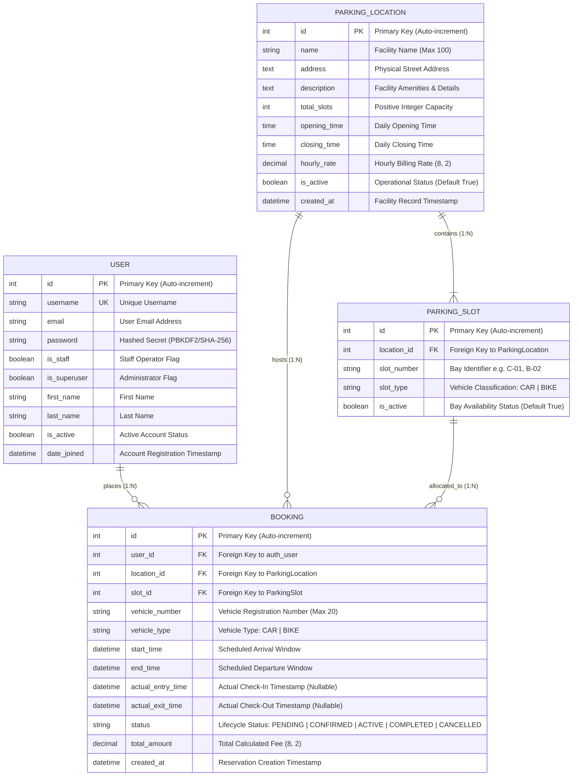

# ParkEase: Entity-Relationship (ER) Diagram & Schema Specification

**Document:** Entity-Relationship (ER) Diagram  
**Project:** Cost-Effective Smart Parking Management System (ParkEase)  
**Architecture:** Django 5.x ORM / Relational Database Schema  

---

## 1. Overview

The ParkEase database schema is designed around four relational entities:
1. **User (`auth_user`)**: Django built-in authentication model supporting Driver, Staff, and Administrator roles.
2. **ParkingLocation (`parking_parkinglocation`)**: Represents a physical parking facility with operating hours, rates, and capacity.
3. **ParkingSlot (`parking_parkingslot`)**: Represents a physical parking bay designated for either Cars or Bikes within a specific facility.
4. **Booking (`bookings_booking`)**: Represents a lifecycle reservation linking a Driver, Facility, and Parking Bay with time tracking and billing metrics.

---

## 2. Mermaid Entity-Relationship Diagram

---

## 3. Relational Constraints & Integrity Rules

1. **Foreign Key Integrity:**
   - `ParkingSlot.location` $\to$ `ParkingLocation` with `on_delete=models.CASCADE`.
   - `Booking.user` $\to$ `User` with `on_delete=models.CASCADE`.
   - `Booking.location` $\to$ `ParkingLocation` with `on_delete=models.CASCADE`.
   - `Booking.slot` $\to$ `ParkingSlot` with `on_delete=models.CASCADE`.

2. **Composite Uniqueness:**
   - `ParkingSlot` enforces a unique constraint on `(location, slot_number)` named `unique_location_slot`.
   - Ensures slot identifiers (e.g., `C-01`) cannot be duplicated within the same physical facility.

3. **Status Enumeration:**
   - `BookingStatus`:
     - `PENDING`: Initial state during payment or confirmation processing.
     - `CONFIRMED`: Active reservation awaiting driver arrival.
     - `ACTIVE`: Vehicle checked in; driver is currently parked in the bay.
     - `COMPLETED`: Vehicle checked out; duration and final fee calculated.
     - `CANCELLED`: Driver or operator cancelled the reservation; releases bay availability.
   - `SlotType` / `VehicleType`:
     - `CAR`: Standard 4-wheeler passenger vehicle.
     - `BIKE`: 2-wheeler motorcycle or scooter.

4. **Model Clean Validation (`clean()`):**
   - Temporal Check: `start_time < end_time`.
   - Slot-Location Coherence: `slot.location_id == location_id`.
   - Type Matching: `slot.slot_type == booking.vehicle_type`.

