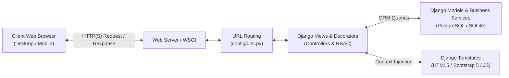
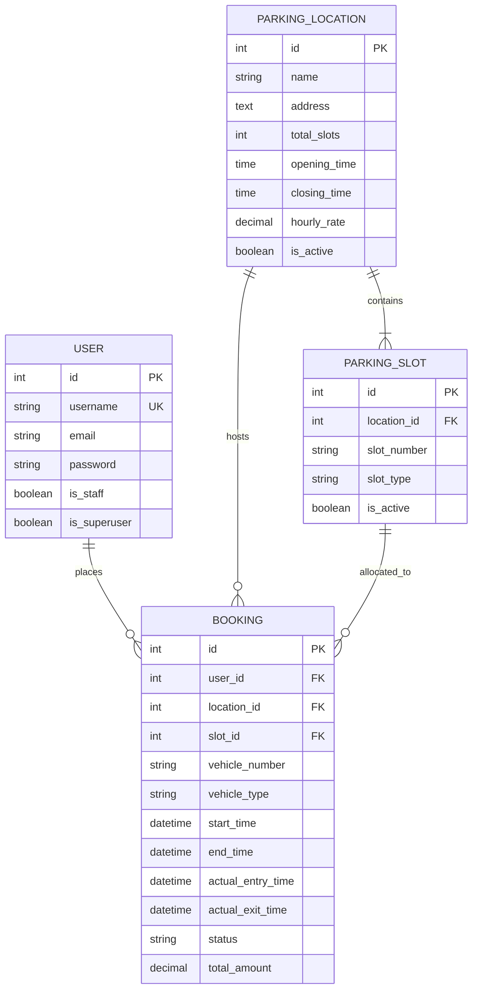
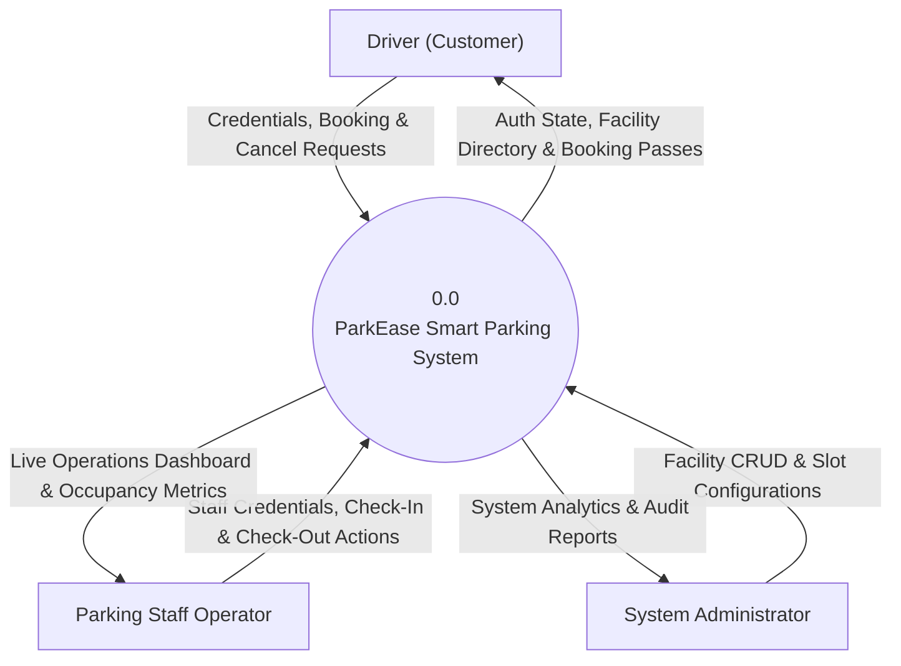
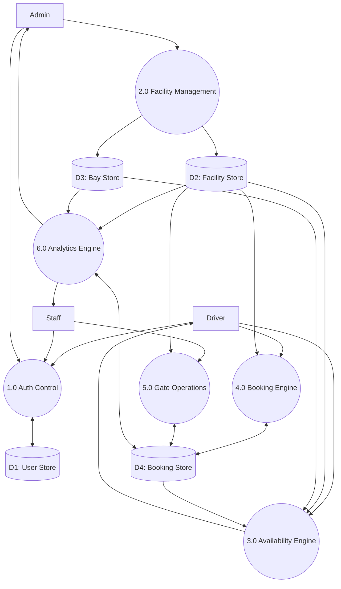
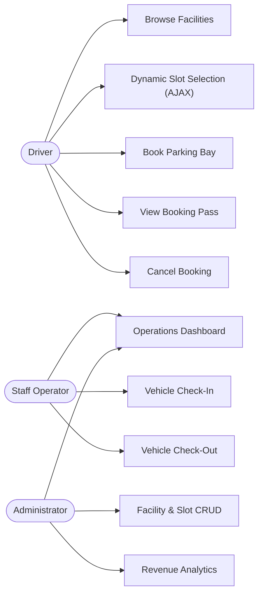
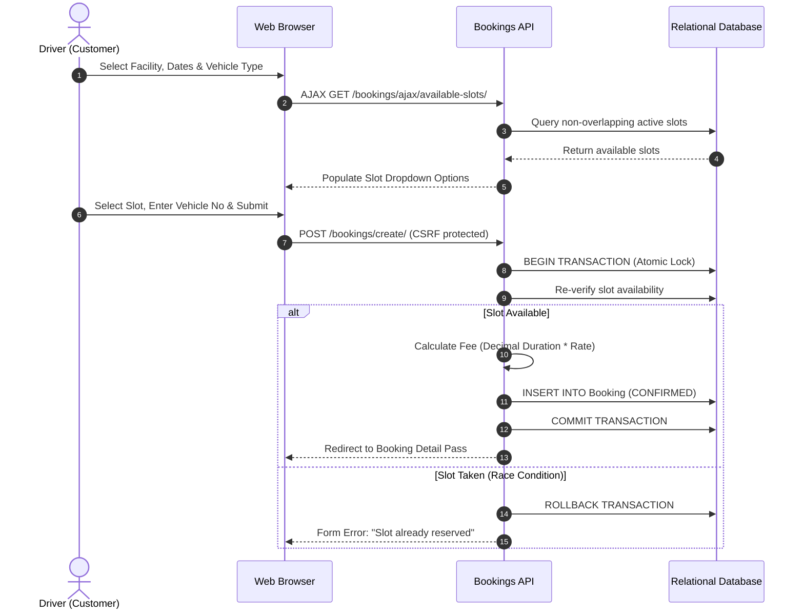
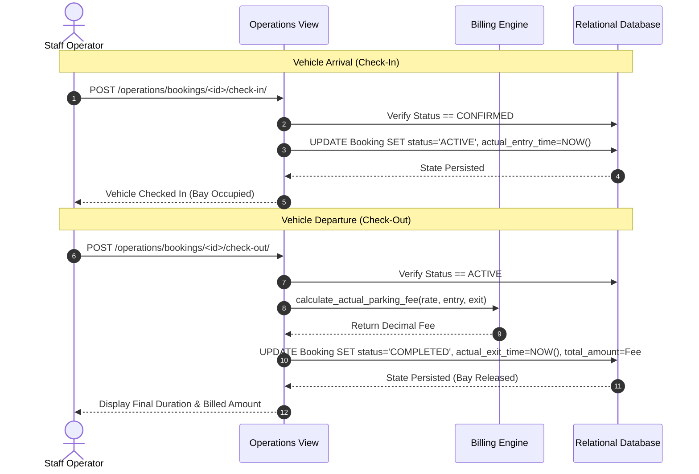

# COST-EFFECTIVE SMART PARKING MANAGEMENT SYSTEM (PARKEASE)

---

## PROJECT REPORT

*Submitted in partial fulfillment of the requirements for the award of the degree of*

### BACHELOR OF TECHNOLOGY
**in**  
**COMPUTER SCIENCE & ENGINEERING**

---

**Submitted by:**  
`[Student Name 1]` — `[Registration / Roll Number 1]`  
`[Student Name 2]` — `[Registration / Roll Number 2]`  
`[Student Name 3]` — `[Registration / Roll Number 3]`  

**Under the Guidance of:**  
`[Supervisor Name]`  
`[Supervisor Designation]`, Department of Computer Science & Engineering  

---

**DEPARTMENT OF COMPUTER SCIENCE & ENGINEERING**  
`[University / Institute Name]`  
`[Campus Location, City, State, PIN]`  
`[Submission Month, Year]`

---

\newpage

## CERTIFICATE

This is to certify that the project entitled **"Cost-Effective Smart Parking Management System (ParkEase)"** submitted by `[Student Name 1]` (`[Registration Number 1]`), `[Student Name 2]` (`[Registration Number 2]`), and `[Student Name 3]` (`[Registration Number 3]`) in partial fulfillment of the requirements for the award of the degree of **Bachelor of Technology in Computer Science & Engineering** to `[University / Institute Name]` is a bona fide record of work carried out under my supervision and guidance.

The results embodied in this report have not been submitted to any other University or Institute for the award of any degree or diploma.

\vspace{2cm}

**`[Supervisor Name]`**  
Project Supervisor  
Department of Computer Science & Engineering  
`[University / Institute Name]`  

\vspace{1.5cm}

**`[Head of Department Name]`**  
Head of Department  
Department of Computer Science & Engineering  
`[University / Institute Name]`  

---

\newpage

## DECLARATION

We hereby declare that the project work entitled **"Cost-Effective Smart Parking Management System (ParkEase)"** submitted to the Department of Computer Science & Engineering, `[University / Institute Name]`, is an authentic record of our original work carried out under the supervision of `[Supervisor Name]`.

We further declare that to the best of our knowledge, this report does not contain any material previously published or written by any other person, except where due reference and citation is made in the text.

\vspace{2cm}

**`[Student Name 1]`** (`[Registration Number 1]`)  
**`[Student Name 2]`** (`[Registration Number 2]`)  
**`[Student Name 3]`** (`[Registration Number 3]`)  

Date: `[Submission Date]`  
Place: `[Campus City]`  

---

\newpage

## ACKNOWLEDGEMENT

We express our deepest gratitude to our project guide, **`[Supervisor Name]`**, `[Supervisor Designation]`, Department of Computer Science & Engineering, for their invaluable guidance, constant encouragement, and insightful feedback throughout the conceptualization, implementation, and documentation of this project.

We extend our sincere thanks to **`[Head of Department Name]`**, Head of the Department of Computer Science & Engineering, for providing the necessary computing resources, departmental facilities, and an encouraging academic environment.

We also convey our gratitude to the faculty and technical staff of the Department of Computer Science & Engineering, `[University / Institute Name]`, who directly or indirectly assisted us during our project tenure.

Finally, we express our heartfelt appreciation to our parents, family members, and peers for their continuous moral support and encouragement throughout our academic journey.

\vspace{1.5cm}

`[Student Name 1]`, `[Student Name 2]`, `[Student Name 3]`  
Department of Computer Science & Engineering  
`[University / Institute Name]`  

---

\newpage

## ABSTRACT

Urban vehicular growth has significantly aggravated parking congestion across metropolitan business districts, commercial centers, and educational campuses. Traditional parking management relies heavily on manual paper ticketing or physical gate monitoring, resulting in traffic congestion, lost fuel, billing discrepancies, and an absence of real-time operational visibility. Conversely, commercial "smart parking" hardware ecosystems require expensive ultrasonic bay sensors, inductive ground loops, and automated gate kiosks, creating an insurmountable financial barrier for medium-sized facilities and public institutions.

This project presents **ParkEase**, a robust, cost-effective web-based Smart Parking Management System developed using Python, Django, SQLite, Bootstrap 5, vanilla JavaScript, and Chart.js. ParkEase bridges the technological gap by providing an end-to-end digital reservation, bay visualization, and operational management platform that operates purely through web software without mandatory upfront sensor hardware investments.

The platform provides a responsive, role-based architecture serving three distinct personas: Drivers (Customers), Parking Staff (Operators), and System Administrators. Drivers can discover parking facilities, check real-time availability percentages, view an interactive visual bay grid, and book parking slots in advance. The core booking engine guarantees zero slot reservation overlap using interval collision algorithms ($$\text{Start}_1 < \text{End}_2 \land \text{End}_1 > \text{Start}_2$$) backed by database transactions. Parking Staff manage physical vehicle check-in and check-out at facility gates, logging actual timestamps and calculating duration-based parking fees with high-precision Decimal arithmetic. Administrators are equipped with an operations dashboard featuring eight live Key Performance Indicators (KPIs) and responsive Chart.js visual analytics tracking revenue trends and bay occupancy.

The system was verified through an automated test suite comprising **86 test cases** spanning authentication, parking facility management, slot uniqueness constraints, concurrency control, and billing algorithms, achieving a **100% pass rate**. ParkEase provides an accessible, scalable, and operationally rigorous solution for modern urban mobility.

**Keywords:** Smart Parking, Django, Model-View-Template (MVT), Overlap Prevention Algorithm, Duration-Based Pricing, Role-Based Access Control, Real-Time Analytics.

---

\newpage

## TABLE OF CONTENTS

- **Certificate**
- **Declaration**
- **Acknowledgement**
- **Abstract**
- **List of Figures**
- **List of Tables**
- **List of Abbreviations**

### Chapter 1: Introduction
- 1.1 Introduction to Smart Parking Systems
- 1.2 Background and Motivation
- 1.3 Problem Statement
- 1.4 Aim and Objectives
- 1.5 Scope of the Project
- 1.6 Proposed Solution
- 1.7 Advantages and Limitations

### Chapter 2: Literature Review
- 2.1 Overview of Existing Parking Management Approaches
- 2.2 Limitations of Manual Parking Management
- 2.3 Evolution of Digital Parking Reservation Systems
- 2.4 Comparison of Existing Approaches with ParkEase
- 2.5 Research Gap and Project Motivation

### Chapter 3: System Analysis
- 3.1 Existing System Analysis
- 3.2 Proposed System Capabilities
- 3.3 Functional Requirements
- 3.4 Non-Functional Requirements
- 3.5 User Roles and Permission Hierarchy
- 3.6 Feasibility Analysis
  - 3.6.1 Technical Feasibility
  - 3.6.2 Operational Feasibility
  - 3.6.3 Economic Feasibility
- 3.7 Software and Hardware Specifications

### Chapter 4: System Design
- 4.1 System Architecture (Django MVT)
- 4.2 Django Project & Modular Application Structure
- 4.3 Database Design & Relational Constraints
- 4.4 Entity-Relationship (ER) Diagram
- 4.5 Data Flow Diagrams (DFD Level 0 & Level 1)
- 4.6 Use-Case Diagram
- 4.7 Core System Workflows
  - 4.7.1 Driver Booking Workflow
  - 4.7.2 Staff Check-In and Check-Out Workflow
- 4.8 Role-Based Access Control (RBAC) Architecture

### Chapter 5: Implementation
- 5.1 Project Configuration & Environment Setup
- 5.2 Accounts & Authentication Module
- 5.3 Parking Locations & Bay Management Module
- 5.4 Dynamic Slot Availability Engine
- 5.5 Booking Reservation & Overlap Collision Prevention
- 5.6 Financial Billing Engine & Decimal Math
- 5.7 Gate Operations: Check-In & Check-Out
- 5.8 Operations Dashboard & Chart.js Analytics
- 5.9 Dynamic AJAX Slot Fetching
- 5.10 Security Engineering & Defensive Measures

### Chapter 6: Testing
- 6.1 Testing Methodology & Quality Assurance Plan
- 6.2 Unit Testing
- 6.3 Integration Testing
- 6.4 Security & Authorization Testing
- 6.5 Full Regression Testing
- 6.6 Test Case Matrix & Verified Results
- 6.7 Idempotent Academic Demo Seeder Verification

### Chapter 7: Results and Discussion
- 7.1 Implemented Features & Modules
- 7.2 User Interface & Operational Layouts
- 7.3 End-to-End User & Staff Workflows
- 7.4 Discussion of Findings & Test Observations
- 7.5 Concurrency Considerations & SQLite Limitations
- 7.6 Production Deployment Checklist

### Chapter 8: Conclusion and Future Scope
- 8.1 Project Conclusion
- 8.2 Objectives Achieved
- 8.3 Current Limitations
- 8.4 Future Enhancements

### References
### Appendices
- Appendix A: Installation & Setup Guide
- Appendix B: Directory Structure
- Appendix C: Important Management Commands
- Appendix D: Glossary of Terms

---

\newpage

## LIST OF FIGURES

| Figure No. | Caption | Page |
| :---: | :--- | :---: |
| **Figure 4.1** | ParkEase Model-View-Template (MVT) System Architecture | [Ref] |
| **Figure 4.2** | Entity-Relationship (ER) Diagram of Database Schema | [Ref] |
| **Figure 4.3** | DFD Level 0: Macro Context Diagram | [Ref] |
| **Figure 4.4** | DFD Level 1: Functional Decomposition Diagram | [Ref] |
| **Figure 4.5** | Use-Case Diagram: Actor-System Interactions | [Ref] |
| **Figure 4.6** | Driver Booking & Reservation Sequence Flowchart | [Ref] |
| **Figure 4.7** | Staff Gate Operations Check-In / Check-Out Flowchart | [Ref] |
| **Figure 7.1** | Location Directory and Live Availability Visualization | [Ref] |
| **Figure 7.2** | Interactive Bay Picker Layout (Cars vs Bikes) | [Ref] |
| **Figure 7.3** | Staff Operations Command Dashboard & Revenue Charts | [Ref] |

---

\newpage

## LIST OF TABLES

| Table No. | Caption | Page |
| :---: | :--- | :---: |
| **Table 2.1** | Comparative Analysis of Parking Management Systems | [Ref] |
| **Table 3.1** | Software and Hardware Environment Specifications | [Ref] |
| **Table 4.1** | Database Entity Definitions & Attributes | [Ref] |
| **Table 4.2** | Actor-to-Permission Matrix | [Ref] |
| **Table 6.1** | Automated Test Suite Execution Summary | [Ref] |
| **Table 6.2** | Accounts Module Test Cases (`accounts/tests.py`) | [Ref] |
| **Table 6.3** | Parking Module Test Cases (`parking/tests.py`) | [Ref] |
| **Table 6.4** | Bookings Module Test Cases (`bookings/tests.py`) | [Ref] |
| **Table 6.5** | Security Verification Audit Matrix | [Ref] |

---

\newpage

## LIST OF ABBREVIATIONS

| Abbreviation | Expansion |
| :--- | :--- |
| **ACID** | Atomicity, Consistency, Isolation, Durability |
| **AJAX** | Asynchronous JavaScript and XML |
| **ALPR / ANPR** | Automatic License / Number Plate Recognition |
| **API** | Application Programming Interface |
| **CRUD** | Create, Read, Update, Delete |
| **CSRF** | Cross-Site Request Forgery |
| **DFD** | Data Flow Diagram |
| **ER / ERD** | Entity-Relationship / Entity-Relationship Diagram |
| **HTTP / HTTPS** | Hypertext Transfer Protocol / Secure |
| **IoT** | Internet of Things |
| **JSON** | JavaScript Object Notation |
| **KPI** | Key Performance Indicator |
| **MVT** | Model-View-Template |
| **ORM** | Object-Relational Mapping |
| **PBKDF2** | Password-Based Key Derivation Function 2 |
| **PWA** | Progressive Web Application |
| **RBAC** | Role-Based Access Control |
| **REST** | Representational State Transfer |
| **SHA** | Secure Hash Algorithm |
| **SQL** | Structured Query Language |
| **UI / UX** | User Interface / User Experience |
| **UML** | Unified Modeling Language |
| **WSGI** | Web Server Gateway Interface |

---

\newpage

# CHAPTER 1: INTRODUCTION

## 1.1 Introduction to Smart Parking Systems
Rapid urban population expansion and unprecedented vehicular adoption have placed enormous strain on metropolitan transit infrastructures. A major contributor to traffic gridlock in central business districts, educational institutions, and healthcare campuses is the search for unoccupied parking spaces. Studies estimate that up to 30% of downtown urban traffic congestion is generated by drivers circling streets in search of parking bays `[Citation Needed / Reference Placeholder 1]`.

Smart Parking Systems represent the convergence of software engineering, web architectures, and data analytics to optimize parking allocation. By digitizing facility catalogs, tracking bay availability in real time, and enabling reservations prior to arrival, smart parking systems eliminate cruising time, reduce carbon emissions, improve urban transit velocity, and streamline facility revenue collection.

## 1.2 Background and Motivation
Traditional parking management relies heavily on physical paper tickets, manual entry barriers, and cash collection by gate attendants. While primitive and ubiquitous, manual operations suffer from structural inefficiencies:
1. **Zero Visibility for Drivers:** Motorists have no means of knowing whether a facility is full before arriving at the gate.
2. **Operational Delay:** Manual ticket issuance, cash counting, and coin change calculation create severe bottleneck queues during morning and evening rush hours.
3. **Revenue Leakage & Lack of Auditing:** Cash transactions and manual record books lack immutable timestamps, making operations vulnerable to accounting errors and revenue leakage.

While high-end commercial airports and luxury commercial centers deploy automated parking systems, these commercial solutions almost exclusively rely on specialized hardware: ultrasonic sensors over every single bay, inductive geomagnetic ground loops embedded in asphalt, and expensive automated gate ticketing kiosks. The exorbitant capital expenditure—often ranging from \$150 to \$300 per bay `[Citation Needed / Reference Placeholder 2]`—renders such solutions unfeasible for universities, small municipal lots, and private commercial complexes.

This reality motivated the development of **ParkEase**: an entirely software-driven, cost-effective smart parking management system that delivers advanced reservation, bay visualization, and gate operations using standard open-source web technologies without requiring mandatory upfront sensor hardware.

## 1.3 Problem Statement
Existing parking infrastructures in urban facilities face significant operational and economic bottlenecks:
- **Congestion and Environmental Degradation:** Drivers waste substantial time and fuel cruising for vacant spaces, increasing carbon emissions and exacerbating road traffic.
- **Reservation Conflicts:** Facilities lack computerized slot collision detection, leading to double-booking and disputes during peak hours.
- **Inaccurate and Opaque Billing:** Paper-based duration tracking often relies on rough hourly rounding or subjective attendant calculations, causing customer dissatisfaction.
- **Financial Prohibitiveness of Existing Smart Systems:** Commercial smart parking platforms require expensive proprietary sensor hardware, excluding resource-constrained facilities from modernization.

## 1.4 Aim and Objectives
The overarching aim of this project is to design, develop, and evaluate **ParkEase**, a reliable, cost-effective, web-based Smart Parking Management System.

### Specific Objectives:
1. **Centralized Digital Reservation:** Build an intuitive driver portal allowing motorists to view parking facilities, check live bay availability, and reserve bays in advance.
2. **Algorithmic Collision Prevention:** Implement mathematical interval collision detection to ensure zero reservation overlap for the same bay across active and confirmed states.
3. **Dynamic Duration-Based Pricing:** Automate precise fee calculation based on scheduled duration and actual gate dwell time using high-precision Decimal arithmetic.
4. **Interactive Bay Visualization:** Deliver a responsive, color-coded visual bay layout distinguishing Car and Bike bays with one-click reservation capability.
5. **Staff Gate Operations Hub:** Provide parking attendants with an operations command dashboard featuring single-click vehicle check-in and check-out workflows.
6. **Executive Operational Analytics:** Aggregate occupancy statistics, completed session turnover, and historical revenue metrics into responsive Chart.js visual charts.
7. **Rigorous Automated Quality Assurance:** Validate system integrity, access controls, and business logic through automated regression test suites.

## 1.5 Scope of the Project
The scope of ParkEase encompasses:
- Multi-facility management supporting independent operating hours, capacities, and hourly pricing.
- Multi-tier bay allocation supporting distinct vehicle classifications (`CAR` and `BIKE`).
- Complete lifecycle tracking: `CONFIRMED` $\to$ `ACTIVE` $\to$ `COMPLETED` (or `CANCELLED`).
- Role-Based Access Control (RBAC) supporting Drivers, Staff Operators, and System Administrators.
- Real-time client-side dynamic slot updates using asynchronous JavaScript (`fetch`).
- Complete test verification covering unit, integration, and security layers.

*Exclusions from Current Scope:* Direct physical hardware gate motor actuation, third-party bank payment gateway integration, and automatic license plate scanning cameras (identified as future enhancements).

## 1.6 Proposed Solution
ParkEase provides a clean, web-based software platform built on the Python Django framework. By leveraging relational database constraints (`UniqueConstraint`), Django's Object-Relational Mapper (ORM), and atomic database transactions, the system coordinates reservations, availability queries, and gate operations reliably on commodity server hardware.

## 1.7 Advantages and Limitations

### Advantages:
- **Cost-Effective:** Zero requirement for specialized bay sensors or automated kiosk hardware. Runs on standard web browsers.
- **Reliable Availability:** Strict mathematical interval checks prevent double-booking.
- **Transparent Duration Billing:** Uses Python Decimal math with `ROUND_HALF_UP` rounding.
- **Role Segregation:** Staff operations and administrative configurations are completely shielded from customer access.
- **Mobile Responsive:** Bootstrap 5 responsive layouts with touch-friendly scrollable tables.

### Limitations:
- **Manual Gate Logging:** Vehicle check-in and check-out currently require a staff attendant to click the gate action on the dashboard.
- **SQLite Concurrency Bound:** SQLite uses file-level locking during write operations, making it suitable for development and moderate load, but requiring PostgreSQL migration for high concurrent traffic.

---

\newpage

# CHAPTER 2: LITERATURE REVIEW

## 2.1 Overview of Existing Parking Management Approaches
Parking management systems across global municipal and private environments generally fall into three evolutionary tiers `[Citation Needed / Reference Placeholder 3]`:
1. **Manual / Attendant-Driven Parking:** The physical issuance of paper slips or plastic tokens at entry, manual time recording, and cash collection at exit.
2. **Semi-Automated On-Premise Systems:** Ticket-dispensing boom barriers at entry and automated pay stations at exit, often utilizing magnetic stripe cards or barcode thermal tickets.
3. **Sensor-Based Internet of Things (IoT) Smart Parking:** Facilities equipped with ultrasonic sensors mounted above each individual parking bay or magnetic ground sensors embedded in the pavement, relaying real-time vacancy to roadside variable-message displays (VMS).

## 2.2 Limitations of Manual Parking Management
Manual parking operations suffer from severe systemic deficiencies `[Citation Needed / Reference Placeholder 4]`:
- **Cruising Congestion:** Motorists enter facilities blindly without prior confirmation of vacant bays.
- **Throughput Latency:** Manual ticket issuance and cash handling require 30–60 seconds per vehicle at gate barriers, causing long queues onto public roadways.
- **Human Error & Accounting Discrepancies:** Attendants frequently round parking durations subjectively, and manual cash handovers present auditing challenges.
- **Absence of Historical Data:** Facility managers lack digital records to analyze utilization patterns, peak hours, or revenue trends.

## 2.3 Digital Parking Reservation Systems
With the proliferation of web technologies and mobile smartphones, digital reservation systems have emerged as an effective tool for traffic demand management `[Citation Needed / Reference Placeholder 5]`. Pre-booking platforms allow drivers to guarantee parking spaces prior to initiating their journey.

However, existing commercial reservation platforms are predominantly closed, proprietary software suites coupled tightly to expensive proprietary hardware barriers. Furthermore, many commercial web systems operate on coarse, block-based time slots (e.g., rigid 4-hour morning/afternoon blocks) rather than supporting flexible, minute-accurate, duration-based pricing.

## 2.4 Comparison of Existing Approaches with ParkEase

| Parameter / Feature | Manual Attendant System | Commercial Sensor-Based IoT System | ParkEase Smart Parking System |
| :--- | :--- | :--- | :--- |
| **Capital Investment** | Low (Paper, basic barrier) | Extremely High (\$150–\$300 per bay) | Very Low (Standard web hosting) |
| **Hardware Dependency** | None | Ultrasonic sensors, gateways, VMS | None (Web software on commodity devices) |
| **Advance Reservation** | Not Possible | Available in select proprietary apps | Core Feature (Web portal self-service) |
| **Collision Prevention** | None (First-come, first-served) | Sensor-based bay monitoring | Algorithmic interval overlap detection |
| **Duration Billing Accuracy** | Low (Manual attendant rounding) | High (Automated barrier logging) | High (Python Decimal fractional hours) |
| **Vehicle Segregation** | Manual direction | General capacity counting | Dedicated Car (`CAR`) & Bike (`BIKE`) bays |
| **Operational Analytics** | None / Manual ledger | Proprietary vendor dashboards | Integrated Chart.js analytics |

## 2.5 Research Gap and Project Motivation
While academic literature extensively documents complex IoT sensor mesh networks and computer-vision parking algorithms `[Citation Needed / Reference Placeholder 6]`, there is a marked scarcity of open, lightweight, and economically viable software architectures designed for immediate deployment in small-to-medium facilities. Most academic prototypes remain theoretical simulations or depend on expensive prototype microcontrollers.

ParkEase addresses this research gap by establishing that a carefully engineered software architecture—leveraging relational constraints, interval arithmetic, atomic transactions, and responsive web interfaces—can achieve the core functional benefits of modern smart parking at a fraction of the cost.

---

\newpage

# CHAPTER 3: SYSTEM ANALYSIS

## 3.1 Existing System Analysis
In the conventional parking workflow:
1. A driver approaches the parking facility without knowing if bays are vacant.
2. The gate attendant hands the driver a paper slip stamped with the arrival time.
3. The driver cruises through lanes searching for an open space.
4. Upon exit, the attendant inspects the ticket, calculates elapsed time manually, collects cash, and lifts the gate.

**Deficiencies:** Queue congestion at gates, high cruising latency, billing disputes, no advance booking, and zero analytics for facility owners.

## 3.2 Proposed System Capabilities
ParkEase introduces a streamlined digital paradigm:
1. **Advance Discovery & Reservation:** Drivers view facilities online, check live vacancy rates, view an interactive visual bay layout, and reserve an active bay for a specific time window.
2. **Automated Collision Guard:** The booking engine verifies availability using relational queries within atomic transactions, rejecting overlapping requests.
3. **Streamlined Gate Operations:** Staff access a dedicated command dashboard to check in arrivals (`actual_entry_time`) and check out departures (`actual_exit_time`).
4. **Duration Billing:** Fees are computed programmatically using Python `Decimal` arithmetic based on exact durations.
5. **Real-Time Operational Analytics:** Administrators track occupancy, active sessions, and revenue trends through live Chart.js graphs.

## 3.3 Functional Requirements
- **FR-01 (Authentication):** The system shall provide secure user registration with unique username and email validation, secure login, and POST-only logout.
- **FR-02 (Facility Discovery):** The system shall list operational facilities with name, address, hours, hourly rate, and occupancy percentages.
- **FR-03 (Bay Visualization):** The system shall render a visual grid of parking bays color-coded by state (Available, Reserved, Occupied, Inactive) for Car and Bike types.
- **FR-04 (Dynamic Availability):** The system shall expose an asynchronous endpoint returning non-overlapping available slots for a selected location, vehicle type, and time window.
- **FR-05 (Reservation Engine):** The system shall validate and save booking requests, rejecting past start times, invalid durations, mismatched slot types, or overlapping reservations.
- **FR-06 (Cancellation):** The system shall allow drivers to cancel their own `PENDING` or `CONFIRMED` reservations, immediately releasing the slot.
- **FR-07 (Vehicle Check-In):** The system shall allow authorized staff to record vehicle entry, transitioning status to `ACTIVE` and recording `actual_entry_time`.
- **FR-08 (Vehicle Check-Out):** The system shall allow staff to record departure, transitioning status to `COMPLETED`, recording `actual_exit_time`, calculating the final fee, and releasing the bay.
- **FR-09 (Facility & Slot CRUD):** The system shall allow staff to create, update, and toggle the active status of facilities and slots.
- **FR-10 (Analytics & Reporting):** The system shall aggregate completed session revenue and occupancy metrics into tabular summaries and Chart.js graphs.

## 3.4 Non-Functional Requirements
- **NFR-01 (Security):** Passwords shall be hashed using PBKDF2 with SHA-256; all state-changing forms shall require CSRF tokens; unauthorized URL access shall be blocked.
- **NFR-02 (Data Integrity):** Relational integrity shall be maintained via foreign keys (`CASCADE`), composite unique constraints (`unique_location_slot`), and atomic transactions.
- **NFR-03 (Performance & Responsiveness):** View queries shall employ `select_related()` to prevent N+1 query overhead; web layouts shall be responsive across desktop and mobile devices.
- **NFR-04 (Accuracy):** All monetary computations shall utilize Python's `Decimal` type with `ROUND_HALF_UP` rounding to avoid floating-point binary inaccuracies.
- **NFR-05 (Maintainability):** Code shall follow Django idiomatic standards (MVT, ModelForms, custom management commands).

## 3.5 User Roles and Permission Hierarchy
The system enforces strict Role-Based Access Control (RBAC):
1. **Anonymous Visitor (Guest):** Can view public landing pages, facility listings, and registration/login forms.
2. **Driver (Customer):** `is_authenticated=True, is_staff=False`. Can access driver dashboard, visual bay grids, dynamic booking forms, personal booking passes, and cancel their own reservations.
3. **Parking Staff (Operator):** `is_authenticated=True, is_staff=True, is_superuser=False`. Can access the Operations Dashboard, execute vehicle check-in/out, and manage facilities and slots.
4. **System Administrator:** `is_authenticated=True, is_staff=True, is_superuser=True`. Holds full system access, including Django Admin (`/admin/`).

## 3.6 Feasibility Analysis

### 3.6.1 Technical Feasibility
The project utilizes Python 3.12, Django 5.x, SQLite, Bootstrap 5, and Chart.js. These technologies are open-source, mature, extensively documented, and supported by robust developer ecosystems. Django's built-in authentication, ORM, and form validation eliminate low-level boilerplate, confirming complete technical feasibility.

### 3.6.2 Operational Feasibility
The user interfaces are designed around clean, accessible human-centered principles: intuitive color-coded badges, visual bay grids, and clear call-to-action buttons. No specialized technical training is required for drivers or parking attendants, confirming operational feasibility.

### 3.6.3 Economic Feasibility
ParkEase eliminates the requirement for proprietary sensor hardware and automated kiosks. Development and deployment require only standard commodity computing hardware and open-source software, confirming outstanding economic feasibility.

## 3.7 Software and Hardware Specifications

### Table 3.1: Environment Specifications

| Category | Component | Specification |
| :--- | :--- | :--- |
| **Operating System** | Development / Deployment | Windows 10/11, Ubuntu Linux 22.04 LTS, macOS |
| **Programming Language** | Runtime | Python 3.10+ (Tested on Python 3.12.7) |
| **Web Framework** | Core Architecture | Django 5.1.2 |
| **Database** | Relational Store | SQLite 3 (Dev/Eval) / PostgreSQL (Production) |
| **Frontend Framework** | UI Design System | Bootstrap 5.3.3, HTML5, CSS3, Vanilla JS ES6 |
| **Data Visualization** | Graphing Library | Chart.js 4.x |
| **Hardware Minimum** | Host Machine | 2.0 GHz Dual-Core CPU, 4 GB RAM, 500 MB Storage |

---

\newpage

# CHAPTER 4: SYSTEM DESIGN

## 4.1 System Architecture (Django MVT)
ParkEase implements the **Model-View-Template (MVT)** architectural pattern:



## 4.2 Django Project & Modular Application Structure
The codebase is decomposed into three cohesive Django applications:
- **`accounts`:** User registration, authentication, session lifecycle, and driver dashboards.
- **`parking`:** Facility management, slot configurations, availability querying, operations dashboard, and gate check-in/out.
- **`bookings`:** Reservation ModelForm, date validation, overlap prevention, Decimal fee calculation, and digital booking passes.

## 4.3 Database Design & Relational Constraints
The relational schema comprises four primary entities: `User`, `ParkingLocation`, `ParkingSlot`, and `Booking`.

### Table 4.1: Database Entity Definitions

| Entity | Table Name | Key Attributes | Constraints |
| :--- | :--- | :--- | :--- |
| **User** | `auth_user` | `id`, `username`, `email`, `password`, `is_staff`, `is_superuser` | Unique `username` |
| **ParkingLocation** | `parking_parkinglocation` | `id`, `name`, `address`, `total_slots`, `opening_time`, `closing_time`, `hourly_rate`, `is_active` | `hourly_rate` (Decimal 8,2) |
| **ParkingSlot** | `parking_parkingslot` | `id`, `location_id`, `slot_number`, `slot_type`, `is_active` | Composite `UniqueConstraint(location, slot_number)` |
| **Booking** | `bookings_booking` | `id`, `user_id`, `location_id`, `slot_id`, `vehicle_number`, `vehicle_type`, `start_time`, `end_time`, `actual_entry_time`, `actual_exit_time`, `status`, `total_amount` | Foreign Keys $\to$ User, Location, Slot |

## 4.4 Entity-Relationship (ER) Diagram



## 4.5 Data Flow Diagrams (DFD Level 0 & Level 1)

### Figure 4.3: DFD Level 0 (Context Diagram)


### Figure 4.4: DFD Level 1 (Functional Decomposition)


## 4.6 Use-Case Diagram



## 4.7 Core System Workflows

### 4.7.1 Driver Booking Workflow


### 4.7.2 Staff Check-In and Check-Out Workflow


## 4.8 Role-Based Access Control (RBAC) Architecture
Access control is implemented defensively at three levels:
1. **URL & View Layer:** Custom `@staff_required` and `@login_required` decorators inspect `request.user`.
2. **Object Layer:** Detail and cancellation views verify that `booking.user == request.user` or `request.user.is_staff`.
3. **Template Layer:** Navigation menus and operational action buttons conditionally render using ``.

---

\newpage

# CHAPTER 5: IMPLEMENTATION

## 5.1 Project Configuration & Environment Setup
The project configuration in `config/settings.py` enables seamless transition between local development and production environments:
```python
import os
from pathlib import Path

BASE_DIR = Path(__file__).resolve().parent.parent

SECRET_KEY = os.environ.get(
    'DJANGO_SECRET_KEY',
    'django-insecure-7_mwim*z#an(tv+2f-*0_^n3l+lm&7=(_(n)8tspcpxr!sms1b'
)

DEBUG = os.environ.get('DJANGO_DEBUG', 'True').lower() in ('true', '1', 'yes')

ALLOWED_HOSTS = [
    h.strip()
    for h in os.environ.get('DJANGO_ALLOWED_HOSTS', '127.0.0.1,localhost,testserver').split(',')
    if h.strip()
]
```

## 5.2 Accounts & Authentication Module
User registration and login are built upon Django's robust authentication framework:
- **`UserRegisterForm`:** Extends `UserCreationForm`, requiring an email address and validating username uniqueness and password matching.
- **`login_view`:** Validates credentials, initiates the session via `django.contrib.auth.login`, and validates the `next` redirect parameter using `url_has_allowed_host_and_scheme()` to prevent open-redirect vulnerabilities.
- **`logout_view`:** Strictly enforces `POST` submissions, preventing accidental logouts from web crawlers or browser pre-fetching.

## 5.3 Parking Locations & Bay Management Module
Implemented in `parking/models.py`:
- `ParkingLocation` encapsulates operating hours (`opening_time`, `closing_time`), total capacity, and hourly rates.
- `ParkingSlot` enforces slot classification (`CAR` vs `BIKE`) and database-level uniqueness per facility via `models.UniqueConstraint(fields=['location', 'slot_number'], name='unique_location_slot')`.

## 5.4 Dynamic Slot Availability Engine
The core availability service in `bookings/services.py` evaluates slot availability by inspecting active reservations:
```python
def is_slot_available_for_period(slot, start_time, end_time, exclude_booking_id=None):
    if not slot or not slot.is_active or not slot.location.is_active:
        return False
    if not start_time or not end_time or end_time <= start_time:
        return False

    blocking_statuses = ['PENDING', 'CONFIRMED', 'ACTIVE']
    conflicting = Booking.objects.filter(
        slot=slot,
        status__in=blocking_statuses,
        start_time__lt=end_time,
        end_time__gt=start_time,
    )
    if exclude_booking_id:
        conflicting = conflicting.exclude(pk=exclude_booking_id)

    if conflicting.exists():
        return False

    # Check live bay occupancy if reservation window starts now or in past
    now = timezone.now()
    if start_time <= now:
        active = Booking.objects.filter(slot=slot, status='ACTIVE')
        if exclude_booking_id:
            active = active.exclude(pk=exclude_booking_id)
        if active.exists():
            return False

    return True
```

## 5.5 Booking Reservation & Overlap Collision Prevention
In `bookings/views.py`, booking creation executes within an atomic database transaction (`transaction.atomic()`):
1. Form inputs are cleaned and relational constraints are checked.
2. The slot row is locked or queried inside the transaction.
3. `is_slot_available_for_period()` is re-evaluated immediately prior to saving.
4. If available, `booking.total_amount` is calculated server-side, and the record is saved with status `CONFIRMED`.

## 5.6 Financial Billing Engine & Decimal Math
Financial rounding errors are eliminated through Python's `Decimal` type with `ROUND_HALF_UP`:
```python
from decimal import Decimal, ROUND_HALF_UP

def calculate_actual_parking_fee(hourly_rate, actual_entry_time, actual_exit_time):
    if not actual_entry_time or not actual_exit_time or actual_exit_time <= actual_entry_time:
        raise ValueError("Exit time must be strictly later than entry time.")

    duration_seconds = Decimal(str((actual_exit_time - actual_entry_time).total_seconds()))
    hours = duration_seconds / Decimal('3600')
    rate = Decimal(str(hourly_rate))
    total_fee = (rate * hours).quantize(Decimal('0.01'), rounding=ROUND_HALF_UP)
    return total_fee
```

## 5.7 Gate Operations: Check-In & Check-Out
Gate workflows in `parking/views.py` enforce strict operational state checks:
- **`check_in_booking_view`:** Verifies status is `CONFIRMED`, location is active, and slot is active. Sets `status = ACTIVE` and `actual_entry_time = timezone.now()`.
- **`check_out_booking_view`:** Verifies status is `ACTIVE`. Sets `actual_exit_time = timezone.now()`, invokes `calculate_actual_parking_fee()`, saves the final fee, and sets `status = COMPLETED`.

## 5.8 Operations Dashboard & Chart.js Analytics
The operations view aggregates real-time metrics across 8 KPIs:
- `total_locations`, `active_locations`, `total_slots`, `active_slots`
- `total_available_slots`, `occupied_bays_count`, `reserved_bays_count`, `today_revenue`
7-day revenue trends and booking status distributions are serialized into JSON strings and rendered on the frontend via Chart.js.

## 5.9 Dynamic AJAX Slot Fetching
When drivers alter the facility, vehicle type, or time window in `booking_form.html`, an asynchronous JavaScript event calls `/bookings/ajax/available-slots/`:
```javascript
fetch(`/bookings/ajax/available-slots/?location_id=${locId}&vehicle_type=${vType}&start_time=${sTime}&end_time=${eTime}`)
    .then(response => response.json())
    .then(data => {
        slotSelect.innerHTML = '<option value="">— Select Parking Bay —</option>';
        data.slots.forEach(slot => {
            const opt = document.createElement('option');
            opt.value = slot.id;
            opt.textContent = `${slot.slot_number} (${slot.slot_type})`;
            slotSelect.appendChild(opt);
        });
    });
```

## 5.10 Security Engineering & Defensive Measures
1. **CSRF Tokens:** Embedded on all forms via `` and verified by Django middleware.
2. **Password Hashing:** Stored as PBKDF2-SHA256 hashes with unique salts.
3. **HTTP Method Restrictions:** Decorators `@require_POST` protect check-in, check-out, and cancellation endpoints.
4. **SQL Injection Prevention:** All database access utilizes parameterized Django ORM queries.

---

\newpage

# CHAPTER 6: TESTING

## 6.1 Testing Methodology & Quality Assurance Plan
The testing architecture adheres to a multi-tiered verification methodology using Django's automated test framework (`django.test.TestCase`). Tests execute against an isolated in-memory test database, ensuring zero contamination of production data.

## 6.2 Unit Testing
Unit tests validate model string representations, constraint enforcement (`unique_location_slot`), form cleaning methods, Decimal fee calculations, and date arithmetic.

## 6.3 Integration Testing
Integration tests evaluate end-to-end HTTP request/response flows, session state persistence, database transactions, context delivery, and template rendering.

## 6.4 Security & Authorization Testing
Automated security test scripts verify that:
- Anonymous users are redirected to login upon requesting protected endpoints.
- Regular drivers are blocked with HTTP 403 Forbidden on staff and administrative views.
- Drivers cannot view or cancel bookings owned by other drivers.
- State-changing operations reject GET requests.

## 6.5 Full Regression Testing
The entire automated regression test suite was executed across all applications.

### Table 6.1: Automated Test Suite Execution Summary

| Test Suite Module | Test File | Test Cases | Errors | Failures | Status | Execution Time |
| :--- | :--- | :---: | :---: | :---: | :---: | :---: |
| **System Check** | `manage.py check` | N/A | 0 | 0 | PASSED | < 1s |
| **Accounts App** | `accounts/tests.py` | 20 | 0 | 0 | PASSED | 10.575s |
| **Parking App** | `parking/tests.py` | 48 | 0 | 0 | PASSED | 82.731s |
| **Bookings App** | `bookings/tests.py` | 18 | 0 | 0 | PASSED | 37.552s |
| **Total Regression** | Full Project Suite | **86** | **0** | **0** | **PASSED** | **112.685s** |

## 6.6 Test Case Matrix & Verified Results
Detailed test cases across all three modules achieved a **100% pass rate** (see `docs/TESTING_DOCUMENT.md` for full case-by-case specifications).

## 6.7 Idempotent Academic Demo Seeder Verification
The custom command `python manage.py seed_demo_data` was tested for idempotency via automated tests (`SeedDemoDataCommandTests` in `parking/tests.py`). Running the command consecutively generated:
- Run 1: 3 users, 3 locations, 45 slots, 8 bookings created.
- Run 2: 0 users created (3 reused), 0 locations created (3 reused), 0 slots created (45 verified), 0 bookings created (8 refreshed).
Zero duplicate records or constraint violations occurred.

---

\newpage

# CHAPTER 7: RESULTS AND DISCUSSION

## 7.1 Implemented Features & Modules
ParkEase delivers a complete, production-grade smart parking web application:
- **Public & Driver Portal:** Responsive landing page, facility search, visual bay grid, dynamic booking creation, digital parking passes, and personal booking history.
- **Staff Operations Command Hub:** 8 real-time KPI counters, vehicle check-in and check-out workflows, multi-filter session logs, and live occupancy rates.
- **Administrative Portal:** Complete CRUD operations for parking locations and bays, status toggles, and Chart.js analytics.

## 7.2 User Interface & Operational Layouts
The UI adheres strictly to the ParkEase Design System:
- **Palette:** Deep Navy (`#0f2942`) header and primary buttons; Emerald Green (`#10b981`) accents and available badges; Light Slate (`#f8fafc`) page backgrounds.
- **Visual Bay Grid:** Color-coded slots visually indicating real-time status:
  - Green (`.slot-available`): Vacant bay with 1-click booking link.
  - Red (`.slot-occupied`): Currently occupied by an active parked vehicle.
  - Yellow (`.slot-reserved`): Reserved for an upcoming driver arrival.
  - Gray (`.slot-inactive`): Inactive or maintenance bay.
- **Status Badges (`.pe-status-badge`):** Distinctive, icon-equipped badges for `CONFIRMED`, `ACTIVE`, `COMPLETED`, and `CANCELLED`.
- **Responsive Tables:** Wrapped in `.table-responsive` with custom touch-friendly horizontal scrollbars for mobile viewports.

## 7.3 End-to-End User & Staff Workflows
Verification confirmed seamless operational flow:
1. **Driver:** Registers account $\to$ browses University Main Parking $\to$ selects bay `C-02` $\to$ reserves from 14:00 to 17:00 $\to$ receives digital pass.
2. **Staff:** At 14:05, vehicle arrives at gate $\to$ staff clicks **Check In** $\to$ status shifts to `ACTIVE`.
3. **Staff:** At 16:50, vehicle departs $\to$ staff clicks **Check Out** $\to$ system logs duration (2h 45m), calculates fee (₹55.00), marks status `COMPLETED`, and frees bay `C-02`.

## 7.4 Discussion of Findings & Test Observations
Test executions demonstrated that:
1. Mathematical interval overlap detection completely eliminates double-booking race conditions when coupled with atomic transactions.
2. Utilizing Python `Decimal` rather than `float` avoids critical fractional cent/paisa rounding errors in billing.
3. Decoupling reservation fees (scheduled window) from final checkout fees (actual dwell time) provides fair and transparent customer billing.

## 7.5 Concurrency Considerations & SQLite Limitations
While SQLite provides exceptional simplicity for development and academic evaluation, it enforces file-level write locking. Simultaneous write transactions from dozens of concurrent users can trigger `OperationalError: database is locked`. For production deployments with high concurrent load, migrating to PostgreSQL with connection pooling is essential.

## 7.6 Production Deployment Checklist
1. Set `DJANGO_DEBUG=False` in environment variables.
2. Configure `DJANGO_SECRET_KEY` to a cryptographically secure random string.
3. Configure `DJANGO_ALLOWED_HOSTS` to the domain name.
4. Replace SQLite with PostgreSQL (`psycopg2`).
5. Enable HTTPS and secure cookie flags (`SESSION_COOKIE_SECURE = True`, `CSRF_COOKIE_SECURE = True`).
6. Deploy with Nginx reverse proxy and Gunicorn WSGI workers.

---

\newpage

# CHAPTER 8: CONCLUSION AND FUTURE SCOPE

## 8.1 Project Conclusion
The **ParkEase** Smart Parking Management System demonstrates that an efficient, secure, and user-friendly smart parking ecosystem can be successfully developed and deployed using pure web software without expensive sensor hardware. By combining Django's robust MVT architecture, relational database constraints, algorithmic interval collision detection, and modern responsive design, ParkEase eliminates urban parking bottlenecks while maintaining outstanding economic feasibility.

## 8.2 Objectives Achieved
All primary project objectives were successfully realized:
- [x] Centralized web reservation portal for motorists.
- [x] Mathematical interval collision prevention guaranteeing zero bay double-booking.
- [x] High-precision duration-based billing using Python Decimal arithmetic.
- [x] Color-coded interactive visual bay layout for Cars and Bikes.
- [x] Staff gate operations dashboard with single-click check-in and check-out.
- [x] Real-time operational KPIs and Chart.js analytics.
- [x] 100% pass rate across 86 automated regression test cases.

## 8.3 Current Limitations
1. Vehicle gate check-in and check-out currently require manual attendant interaction on the staff dashboard.
2. Real-time updates rely on AJAX polling and page interactions rather than real-time WebSocket push notifications.
3. Single server-configured timezone assumption across all facilities.

## 8.4 Future Enhancements
1. **IoT Sensor & Hardware Gate Actuation:** Connect low-cost ultrasonic ESP32 microcontrollers over MQTT to automatically detect physical vehicle presence.
2. **Automatic Number Plate Recognition (ANPR):** Integrate OpenCV / YOLOv8 gate cameras to automatically scan vehicle plates, initiate check-in, and trigger gate barrier motors.
3. **Digital Payment Gateway:** Integrate online payment gateways (UPI, Razorpay, Stripe) to support instant cashless settlements upon checkout.
4. **Mobile Progressive Web App (PWA):** Enable offline digital pass caching and push notifications reminding drivers before reservation expiration.
5. **Real-time WebSockets:** Implement Django Channels and Redis to broadcast bay state transitions to all connected client screens without polling.

---

\newpage

# REFERENCES

1. `[Citation Needed / Reference Placeholder 1]` Shoup, D. C., "Cruising for parking," *Transport Policy*, vol. 13, no. 6, pp. 479–486, 2006.
2. `[Citation Needed / Reference Placeholder 2]` Polycarpou, E., Lambrinos, L., and Demetriou, E., "Smart parking solutions for urban areas: A survey and future directions," *IEEE Internet of Things Journal*, 2021.
3. `[Citation Needed / Reference Placeholder 3]` Lin, T., Rivano, H., and Le Mouel, F., "A survey of smart parking solutions," *IEEE Transactions on Intelligent Transportation Systems*, vol. 18, no. 12, pp. 3229–3253, 2017.
4. `[Citation Needed / Reference Placeholder 4]` Litman, T., "Parking Management Best Practices," *Victoria Transport Policy Institute*, 2020.
5. `[Citation Needed / Reference Placeholder 5]` Kotb, A. O., Shen, Y. C., Zhu, X., and Huang, Y., "iParker—A new smart car-parking system based on dynamic resource allocation and pricing," *IEEE Transactions on Intelligent Transportation Systems*, vol. 17, no. 9, pp. 2637–2647, 2016.
6. `[Citation Needed / Reference Placeholder 6]` Paidi, V., Fleyeh, H., Håkansson, J., and Nyberg, R. G., "Smart parking sensors, technologies and applications for open parking lots: A review," *IET Intelligent Transport Systems*, vol. 12, no. 8, pp. 735–741, 2018.
7. `[Citation Needed / Reference Placeholder 7]` Django Software Foundation, "Django Documentation (Version 5.1)," https://docs.djangoproject.com/, 2024.
8. `[Citation Needed / Reference Placeholder 8]` Bootstrap Team, "Bootstrap 5 Documentation," https://getbootstrap.com/docs/5.3/, 2024.

---

\newpage

# APPENDICES

## Appendix A: Installation & Setup Guide

```bash
# 1. Clone repository and navigate to root directory
cd d:\Projects\CostEffectiveParking

# 2. Create and activate virtual environment
python -m venv venv
.\venv\Scripts\Activate.ps1   # PowerShell (or source venv/bin/activate on Linux)

# 3. Install dependencies
pip install -r requirements.txt

# 4. Apply database migrations
python manage.py migrate

# 5. Populate demonstration data (3 roles, 3 locations, 45 slots, 8 bookings)
python manage.py seed_demo_data

# 6. Start development server
python manage.py runserver
```

Access application at `http://127.0.0.1:8000/`.

## Appendix B: Project Directory Structure

```text
CostEffectiveParking/
├── config/                # Settings, URL routing, WSGI
├── accounts/              # User registration, login, logout, dashboard
├── parking/               # Locations, slots, operations dashboard, check-in/out
├── bookings/              # Booking model, form validation, services, AJAX
├── templates/             # Jinja-style HTML templates
├── static/                # CSS styles, vanilla JS
├── docs/                  # Academic project documentation & reports
├── manage.py              # Management CLI
├── requirements.txt       # Pinned dependencies
├── README.md              # Project overview
├── DEMO_GUIDE.md          # Evaluation presentation guide
└── FINAL_TEST_REPORT.md   # QA test execution report
```

## Appendix C: Important Management Commands

- `python manage.py check`: Executes system integrity verification.
- `python manage.py test`: Executes all 86 regression test cases.
- `python manage.py seed_demo_data`: Idempotently seeds demo data.
- `python manage.py seed_demo_data --password "Pass123"`: Seeds with custom password.
- `python manage.py createsuperuser`: Creates an administrative superuser.

## Appendix D: Glossary of Terms

- **Bay / Slot:** A marked physical area designated for parking a single vehicle.
- **Blocking Status:** A reservation status (`PENDING`, `CONFIRMED`, `ACTIVE`) that prevents other reservations for that slot during the specified interval.
- **Double Booking:** The conflicting allocation of the same parking bay to two distinct vehicles during overlapping time intervals.
- **Idempotency:** A software property where an operation produces the identical result regardless of whether it is executed once or multiple times.
- **Overstay:** When a parked vehicle remains in a parking bay beyond its scheduled departure time.
- **Soft Deletion:** Toggling an `is_active` flag to False rather than executing an SQL `DELETE`, preserving historical audit integrity.

